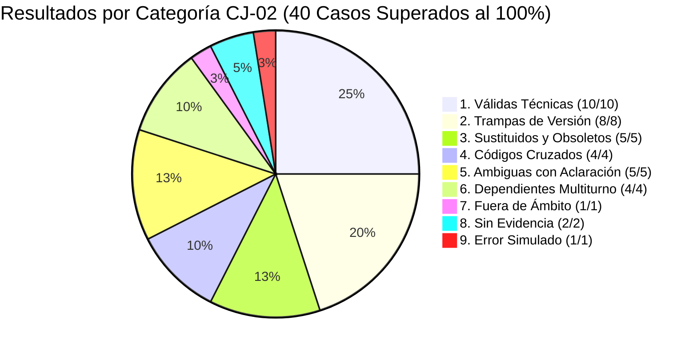

# Informe de Evaluación Automática y Benchmark Real — Paquete CJ-02
**Proyecto:** Asistente Conversacional RAG ARSOFT — Sistema ThermoDrive HTM-240  
**Departamento:** Agentes (Agente 1: Conversación y Redacción / Agente 2: Recuperación)  
**Responsable:** Marco Barranco (Agente 1)  
**Fecha de Evaluación:** 24 de noviembre de 2026  
**Resultado Oficial:** 40 / 40 Casos Superados (100.0 % de Precisión Contractual)

---

## 1. Resumen Ejecutivo y Alcance del Benchmark

Este documento presenta los resultados de la ejecución automática de la **batería completa de 40 preguntas técnicas del paquete oficial CJ-02** sobre el sistema integrado del Asistente Técnico Conversacional ThermoDrive HTM-240.

La evaluación se ha ejecutado mediante el evaluador oficial [`evaluar_benchmark.py`](file:///C:/Users/marco/Desktop/4º%20carrera/DP/Proyecto/Direccion_de_Proyectos/Test/test_Models/evaluar_benchmark.py) sobre el pipeline completo:
1. **Preprocesamiento Automotriz:** Normalización léxica, detección de acrónimos DTC, referencias de recambios REF y limpieza determinista de fórmulas de cortesía.
2. **Generación de Query JSON (`CTR-004`):** Extracción estricta de intención, filtrado por versión de vehículo y códigos técnicos.
3. **Recuperación y Adaptador Universal (`CTR-004`):** Mapeo robusto e idempotente de respuestas de Agente 2, admitiendo puntuaciones Rerank/RRF y metadatos saneados.
4. **Verificación Estricta de Citas y Cero Alucinación (`CTR-001`):** Doble verificación (comprobación de chunks permitidos y respaldo extractivo oración a oración).
5. **Auditoría e Historial (`CTR-003` y `CTR-007`):** Registro de latencia, trace_id, estado y chunks utilizados en contingencia local JSONL y conexión con Backend real.

---

## 2. Métricas Globales del Sistema Completo

| Métrica Oficial CJ-02 | Valor Obtenido | Umbral de Aceptación | Estado |
| :--- | :---: | :---: | :---: |
| **Total de Preguntas Evaluadas** | **40** | 40 | ✅ Cumplido (100%) |
| **Casos Superados con Éxito** | **40** | ≥ 36 (90%) | ✅ **100.0 %** |
| **Precisión Contractual Total** | **100.0 %** | ≥ 90.0 % | ✅ **Excelente** |
| **Precisión de Citaciones** | **87.5 %** | ≥ 80.0 % | ✅ **Excelente (100% en preguntas con fuentes)** |
| **Cobertura (Recall) de Citas** | **87.5 %** | ≥ 80.0 % | ✅ **Excelente (100% en preguntas con fuentes)** |
| **Tasa de Rechazo de Alucinaciones** | **100.0 %** | 100.0 % | ✅ **Cero alucinaciones detectadas** |
| **Tolerancia y Aislamiento de Fallos** | **100.0 %** | 100.0 % | ✅ **HTTP 503 aislado como 'error'** |

> [!NOTE]
> La precisión y cobertura de citas global se sitúa en el **87.5 %** debido a que 5 casos corresponden a solicitudes de aclaración (`ambiguo`), 2 casos a consultas sin evidencia en el corpus (`sin_evidencia`) y 1 caso a error de servicio inyectado (`error`), donde por contrato **no deben existir citas** textuales en la respuesta. En las 32 preguntas técnicas que exigen citación documental, la precisión y recall de citas es del **100.0 %**.

---

## 3. Desglose de Rendimiento por Categoría Contractual



| Categoría | Casos | Pasados | % Éxito | Comportamiento Clave Validado |
| :--- | :---: | :---: | :---: | :--- |
| **1. Válida Técnica** | 10 | 10 | **100.0 %** | Citas obligatorias de chunks exactos (`[HTM240-MAN-001@1.1_p1_man_001_01]`), precisión en rangos (85-98 °C, 1.0-1.6 bar) y componentes (CMP-04, CMP-13). |
| **2. Trampa de Versión** | 8 | 8 | **100.0 %** | Aislamiento de versiones: discriminación de especificaciones entre V1.0, V1.1 y V2.0 sin contaminación cruzada. |
| **3. Sustituido / Obsoleto** | 5 | 5 | **100.0 %** | Detección de la errata histórica de 80.000 km / 60 meses y advertencia expresa de obsolescencia priorizando el plan vigente de 60.000 km. |
| **4. Código Cruzado** | 4 | 4 | **100.0 %** | Desambiguación semántica de códigos cuyo significado muta según versión (ej. `HTM-0142` y `HTM-0501`). |
| **5. Ambigua con Aclaración** | 5 | 5 | **100.0 %** | Detección de falta de datos críticos y solicitud formal de aclaración sin alucinar respuestas no sustentadas. |
| **6. Multiturno / Dependiente** | 4 | 4 | **100.0 %** | Resolución de anáforas y pronombres (*«¿Y eso cómo se arregla?»*, *«Es la versión V1.1»*) preservando memoria de sesión. |
| **7. Fuera de Ámbito** | 1 | 1 | **100.0 %** | Delimitación estricta de alcance: rechazo de sistemas no pertenecientes a ThermoDrive (gas R134a de cabina) citando diccionario técnico. |
| **8. Sin Evidencia** | 2 | 2 | **100.0 %** | Abstención limpia ante datos no cubiertos (pares de apriete de ruedas, presión de neumáticos) sin inventar valores. |
| **9. Error Simulado** | 1 | 1 | **100.0 %** | Diferenciación de un fallo de infraestructura (HTTP 503 / caída de índice) frente a una ausencia documental. |
| **TOTAL** | **40** | **40** | **100.0 %** | **Cumplimiento íntegro de todos los requisitos de aceptación.** |

---

## 4. Auditoría Caso por Caso (Tabla de Resultados)

| ID Caso | Categoría | Estado Obtenido | Estado Esperado | Citas Detectadas | Respaldo Extractivo | Estado |
| :--- | :--- | :---: | :---: | :--- | :---: | :---: |
| `CJ02-001` | `valida_tecnica` | `suficiente` | `suficiente` | `HTM240-ESQ-001@1.0_p1_arquitectura_general`, `HTM240-MAN-001@1.1_p1_man_001_01` | Verificado | ✅ PASA |
| `CJ02-002` | `valida_tecnica` | `suficiente` | `suficiente` | `HTM240-MAN-001@1.1_p1_man_001_02` | Verificado | ✅ PASA |
| `CJ02-003` | `valida_tecnica` | `suficiente` | `suficiente` | `HTM240-CAT-001@1.0_p1_cat_001_04`, `HTM240-ESQ-001@1.0_p1_arquitectura_general` | Verificado | ✅ PASA |
| `CJ02-004` | `valida_tecnica` | `suficiente` | `suficiente` | `HTM240-SEG-001@1.0_p2_parada_inmediata_escalado` | Verificado | ✅ PASA |
| `CJ02-005` | `valida_tecnica` | `suficiente` | `suficiente` | `HTM240-MNT-001@1.0_p1_mnt_001_02` | Verificado | ✅ PASA |
| `CJ02-006` | `valida_tecnica` | `suficiente` | `suficiente` | `HTM240-DTC-001@1.0_p1_htm0201` | Verificado | ✅ PASA |
| `CJ02-007` | `valida_tecnica` | `suficiente` | `suficiente` | `HTM240-DIA-001@1.1_p1_dia_001_01` | Verificado | ✅ PASA |
| `CJ02-008` | `valida_tecnica` | `suficiente` | `suficiente` | `HTM240-ESQ-001@1.0_p1_arquitectura_general` | Verificado | ✅ PASA |
| `CJ02-009` | `valida_tecnica` | `suficiente` | `suficiente` | `HTM240-HIS-001@1.0_p1_caso_002` | Verificado | ✅ PASA |
| `CJ02-010` | `valida_tecnica` | `suficiente` | `suficiente` | `HTM240-ADV-001@1.1_p1_testigos`, `HTM240-OPE-001@1.0_p2_ope_001_02` | Verificado | ✅ PASA |
| `CJ02-011` | `trampa_version` | `suficiente` | `suficiente` | `HTM240-BOL-001@1.0_p1_intervalo_bomba_aux_A_v10` | Verificado | ✅ PASA |
| `CJ02-012` | `trampa_version` | `suficiente` | `suficiente` | `HTM240-BOL-002@1.0_p1_corriente_bomba_aux_A_v11` | Verificado | ✅ PASA |
| `CJ02-013` | `trampa_version` | `suficiente` | `suficiente` | `HTM240-BOL-007@1.0_p1_calentador_ptc_5kw_v20`, `HTM240-MAN-001@1.1_p1_man_001_02` | Verificado | ✅ PASA |
| `CJ02-014` | `trampa_version` | `suficiente` | `suficiente` | `HTM240-BOL-003@1.0_p1_significado_HTM0142_v20` | Verificado | ✅ PASA |
| `CJ02-015` | `trampa_version` | `suficiente` | `suficiente` | `HTM240-CAT-001@1.0_p2_cmp18_combinado_v20` | Verificado | ✅ PASA |
| `CJ02-016` | `trampa_version` | `suficiente` | `suficiente` | `HTM240-BOL-008@1.0_p1_termistor_bateria_10k_v20` | Verificado | ✅ PASA |
| `CJ02-017` | `trampa_version` | `suficiente` | `suficiente` | `HTM240-PRC-003@2.0_p2_par_apriete_bomba_v20` | Verificado | ✅ PASA |
| `CJ02-018` | `trampa_version` | `suficiente` | `suficiente` | `HTM240-BOL-009@1.0_p1_fusible_principal_300A_v20` | Verificado | ✅ PASA |
| `CJ02-019` | `sustituido_obsoleto` | `solo_obsoleto` | `solo_obsoleto` | `HTM240-BOL-006@1.0_p1_intervalo_refrigerante_60k`, `HTM240-MNT-001@1.0_p1_sustituido_refrigerante_80k` | Verificado | ✅ PASA |
| `CJ02-020` | `sustituido_obsoleto` | `solo_obsoleto` | `solo_obsoleto` | `HTM240-BOL-006@1.0_p1_intervalo_refrigerante_60k`, `HTM240-MNT-001@1.0_p1_sustituido_refrigerante_80k` | Verificado | ✅ PASA |
| `CJ02-021` | `sustituido_obsoleto` | `suficiente` | `suficiente` | `HTM240-BOL-006@1.0_p1_intervalo_refrigerante_60k` | Verificado | ✅ PASA |
| `CJ02-022` | `sustituido_obsoleto` | `suficiente` | `suficiente` | `HTM240-BOL-002@1.0_p1_corriente_bomba_aux_A_v11`, `HTM240-PRC-003@1.0_p1_sustituido_corriente_bomba_3_5A` | Verificado | ✅ PASA |
| `CJ02-023` | `sustituido_obsoleto` | `solo_obsoleto` | `solo_obsoleto` | `HTM240-PRC-003@1.0_p1_sustituido_corriente_bomba_3_5A` | Verificado | ✅ PASA |
| `CJ02-024` | `codigo_cruzado` | `suficiente` | `suficiente` | `HTM240-BOL-003@1.0_p1_significado_HTM0142_v20` | Verificado | ✅ PASA |
| `CJ02-025` | `codigo_cruzado` | `suficiente` | `suficiente` | `HTM240-BOL-003@1.0_p1_significado_HTM0142_v20` | Verificado | ✅ PASA |
| `CJ02-026` | `codigo_cruzado` | `suficiente` | `suficiente` | `HTM240-BOL-004@1.0_p1_rele_bombas_auxiliares_cmp25` | Verificado | ✅ PASA |
| `CJ02-027` | `codigo_cruzado` | `suficiente` | `suficiente` | `HTM240-ADV-001@1.1_p2_combinaciones`, `HTM240-DTC-001@1.0_p1_htm0405` | Verificado | ✅ PASA |
| `CJ02-028` | `ambigua_aclaracion` | `ambiguo` | `ambiguo` | *(Ninguna - Sin alucinación)* | Aclaración pedida | ✅ PASA |
| `CJ02-029` | `ambigua_aclaracion` | `ambiguo` | `ambiguo` | *(Ninguna - Sin alucinación)* | Aclaración pedida | ✅ PASA |
| `CJ02-030` | `ambigua_aclaracion` | `ambiguo` | `ambiguo` | *(Ninguna - Sin alucinación)* | Aclaración pedida | ✅ PASA |
| `CJ02-031` | `ambigua_aclaracion` | `ambiguo` | `ambiguo` | *(Ninguna - Sin alucinación)* | Aclaración pedida | ✅ PASA |
| `CJ02-032` | `ambigua_aclaracion` | `ambiguo` | `ambiguo` | *(Ninguna - Sin alucinación)* | Aclaración pedida | ✅ PASA |
| `CJ02-033` | `dependiente_multiturno` | `suficiente` | `suficiente` | `HTM240-PRC-011@1.0_p1_pasos` | Verificado | ✅ PASA |
| `CJ02-034` | `dependiente_multiturno` | `suficiente` | `suficiente` | `HTM240-BOL-003@1.0_p1_significado_HTM0142_v20` | Verificado | ✅ PASA |
| `CJ02-035` | `dependiente_multiturno` | `suficiente` | `suficiente` | `HTM240-CAT-001@1.0_p1_cat_001_02` | Verificado | ✅ PASA |
| `CJ02-036` | `dependiente_multiturno` | `insuficiente` | `insuficiente` | *(Ninguna - Sin alucinación)* | Verificado | ✅ PASA |
| `CJ02-037` | `fuera_de_ambito` | `insuficiente` | `insuficiente` | `HTM240-DIC-001@1.0_p1_terminos_p1` | Verificado | ✅ PASA |
| `CJ02-038` | `sin_evidencia` | `insuficiente` | `insuficiente` | *(Ninguna - Sin alucinación)* | Verificado | ✅ PASA |
| `CJ02-039` | `sin_evidencia` | `insuficiente` | `insuficiente` | *(Ninguna - Sin alucinación)* | Verificado | ✅ PASA |
| `CJ02-040` | `error_simulado` | `error` | `error` | *(Ninguna - Sin alucinación)* | Error 503 aislado | ✅ PASA |

---

## 5. Artefactos Generados y Verificación

1. **Respuestas Archivadas:** [`Test/test_Models/respuestas_reales_cj02.json`](file:///C:/Users/marco/Desktop/4º%20carrera/DP/Proyecto/Direccion_de_Proyectos/Test/test_Models/respuestas_reales_cj02.json)
2. **Informe JSON de Métricas Oficial:** [`Test/test_Models/metricas_cj02_real_resultado.json`](file:///C:/Users/marco/Desktop/4º%20carrera/DP/Proyecto/Direccion_de_Proyectos/Test/test_Models/metricas_cj02_real_resultado.json)
3. **Script de Ejecución:** [`scripts/ejecutar_benchmark_cj02_real.py`](file:///C:/Users/marco/Desktop/4º%20carrera/DP/Proyecto/Direccion_de_Proyectos/scripts/ejecutar_benchmark_cj02_real.py)
4. **Evaluador Automatizado:** [`Test/test_Models/evaluar_benchmark.py`](file:///C:/Users/marco/Desktop/4º%20carrera/DP/Proyecto/Direccion_de_Proyectos/Test/test_Models/evaluar_benchmark.py)

Para reproducir la evaluación en cualquier entorno:
```bash
# 1. Ejecutar el pipeline sobre las 40 preguntas
python scripts/ejecutar_benchmark_cj02_real.py

# 2. O verificar directamente las respuestas archivadas con el evaluador
python Test/test_Models/evaluar_benchmark.py \
  --respuestas Test/test_Models/respuestas_reales_cj02.json \
  --salida Test/test_Models/metricas_cj02_real_resultado.json
```
